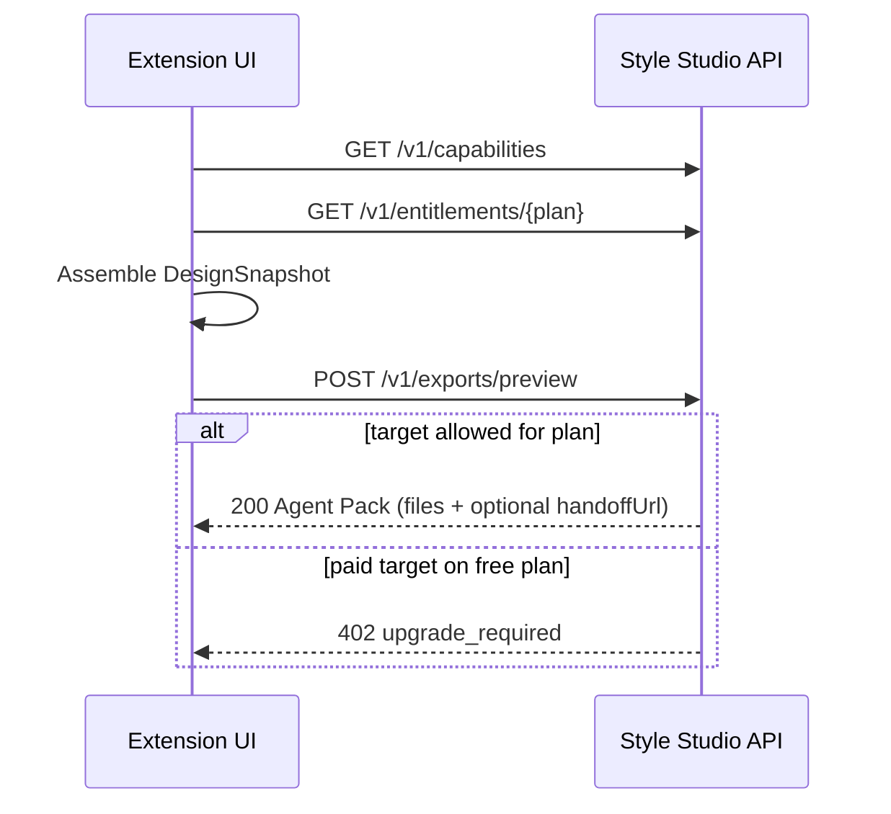

<div align="center">

# Style Studio

**Capture any website's design and hand it to your AI coding tool as a ready-to-use Agent Pack.**


</div>

---

## About

Style Studio is a Chrome extension concept for designers and developers who build with AI agents: pick up the visual language of a page (colors, typography, spacing, radii, shadows, changed selectors), tweak it visually, and export it as an **Agent Pack** tailored to Claude Code, Codex, Cursor, Windsurf or Lovable.

This repository contains the **backend and the typed core contracts**: a Hono API that validates design snapshots, enforces Free / Pro / Team plan gating, and generates the agent-specific export files. The extension UI is built separately against this API, following the spec in [`docs/frontend-spec.md`](./docs/frontend-spec.md).

## Features

- **Typed design-snapshot contract**: Zod schemas for color and typography tokens, spacing, radii, shadows, generated CSS and changed selectors, with sensible size limits.
- **Agent Pack generation**: every export produces `IMPLEMENTATION.md`, `design-tokens.json`, `styles.css` and `changes.json`, plus a target-specific rules file:
  - Claude Code: `CLAUDE.style-studio.md`
  - Codex: `AGENTS.style-studio.md`
  - Cursor: `.cursor/rules/style-studio.mdc`
  - Windsurf: `.windsurf/rules/style-studio.md`
  - Lovable: a Build-with-URL handoff link with the brief prefilled
- **Export modes**: restyle existing app, generate new, tokens only, selected component, fix inconsistencies. Frameworks: HTML, React, Next.js, Vue, Svelte; styling: CSS, SCSS, Tailwind.
- **Plan entitlements**: Free, Pro and Team feature gates (saved projects, versions, responsive/state editing, export targets) served by the API, which is the single source of truth. Paid targets on a free plan return `402 upgrade_required`.
- **Capabilities endpoint**: targets, frameworks and styling systems are served by the API so the UI never hard-codes them.
- **Privacy boundary by design**: contracts accept visual tokens, generated CSS and selectors only, never cookies, form values, browsing history or the full DOM.
- **Tested**: Vitest suites for the API, plan gating and export generation; OpenAPI spec in `docs/openapi.yaml`.

## Tech stack

| Area | Technology |
| --- | --- |
| Runtime | Node.js (ES modules) via `tsx` |
| HTTP framework | Hono + `@hono/node-server` |
| Validation / contracts | Zod 4 |
| Language | TypeScript (strict) |
| Testing | Vitest |
| API docs | OpenAPI 3 (`docs/openapi.yaml`) |
| Planned extension UI | WXT, Preact, Preact Signals, CSS Modules, CodeMirror 6 |

## How it works



### API

| Method | Endpoint | Description |
| --- | --- | --- |
| `GET` | `/health` | Service health check |
| `GET` | `/v1/capabilities` | Supported export targets, frameworks and styling systems |
| `GET` | `/v1/entitlements/:plan` | Feature gates for `free`, `pro` or `team` |
| `POST` | `/v1/exports/preview` | Validates a design snapshot and returns the generated Agent Pack as named text files |

Paid adapter requested on a free plan:

```json
{
  "error": "upgrade_required",
  "requiredPlan": "pro"
}
```

## Getting started

**Prerequisites:** Node.js 20+ and npm.

```bash
npm install
npm run dev        # API with hot reload on http://localhost:8787
npm start          # run without watch mode
npm run typecheck  # tsc --noEmit
npm test           # Vitest
```

Copy `.env.example` to `.env`. Only `PORT` is used by the current milestone; the remaining variables are reserved for upcoming milestones:

`PORT`, `APP_ORIGIN`, `DATABASE_URL`, `SUPABASE_URL`, `SUPABASE_SERVICE_ROLE_KEY`, `BILLING_WEBHOOK_SECRET`, `R2_BUCKET`

## Project structure

```
.
├── src/
│   ├── index.ts                     # Node server entry
│   ├── app.ts                       # Hono routes
│   ├── contracts/export.ts          # Zod schemas: snapshot, export request, Agent Pack
│   ├── billing/entitlements.ts      # Free / Pro / Team feature gates
│   └── exports/generate-agent-pack.ts  # Agent Pack + per-target adapters
├── tests/                           # Vitest: API, entitlements, export
├── docs/
│   ├── openapi.yaml                 # API specification
│   ├── frontend-spec.md             # extension UI specification
│   └── fable-integration.md         # frontend integration handoff
└── CLAUDE.md                        # instructions for frontend agents
```

## Roadmap

Current milestone (done): entitlement definitions, typed snapshot and export contracts, Universal / Codex / Claude Code / Cursor / Windsurf / Lovable adapters, Lovable Build-with-URL handoff, Hono API with validation and upgrade responses, unit tests.

Next backend milestones:

1. PostgreSQL project/version schema and repository layer
2. Supabase JWT verification
3. Billing webhook and durable entitlement lookup
4. ZIP generation and R2 signed downloads
5. Extension core package for DOM analysis and CSS application

## Development notes

Frontend agents must read [`CLAUDE.md`](./CLAUDE.md) and [`docs/frontend-spec.md`](./docs/frontend-spec.md) before creating the WXT extension under `extension/`. The frontend integration flow is described in [`docs/fable-integration.md`](./docs/fable-integration.md). Backend entitlement responses are authoritative; the UI must not infer paid access locally.

---

<div align="center">

Built by [Christoph Barton](https://christophbarton.com)

</div>
